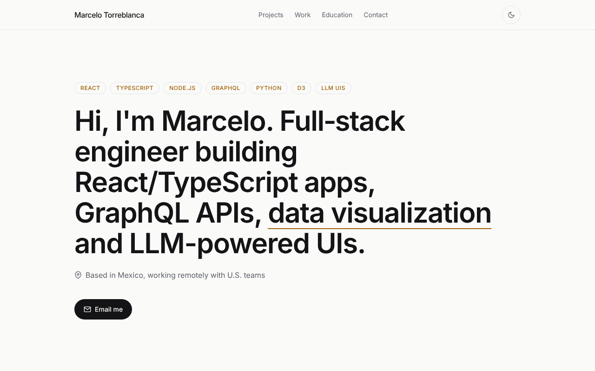

# Marcelo Torreblanca · Portfolio

A one-page portfolio of my personal projects and professional work: React/TypeScript apps,
GraphQL APIs, data visualization and LLM-powered UIs.



## What's inside

- **Projects:** personal builds with live demos and code, such as
  [DC Mini Explorer](https://github.com/mtorreblanca/dc-mini-explorer) (React + TypeScript + D3)
  and [Promptdeck](https://github.com/mtorreblanca/Promptdeck) (prompt evaluation across LLM providers).
- **Selected work:** short case studies of production work (Walmart Global Tech, NBC, Guros and more):
  the context, my exact share of the work, the outcome and, where possible, a screenshot of the
  public page.
- **Education & certifications** and **contact**.

## Tech stack

[Astro 7](https://astro.build) · TypeScript · Tailwind CSS 4 · React (for interactive islands) ·
Inter variable font · light/dark theme

The site ships as static HTML with almost no JavaScript. Case studies are Markdown files in an
Astro [content collection](https://docs.astro.build/en/guides/content-collections/) with a Zod schema,
so a card with a missing field fails the build instead of shipping half-filled.

## Getting started

Requires Node.js 22.

```bash
npm install
npm run dev       # http://localhost:4321
npm run build     # static site in dist/
npm run preview   # serve the production build locally
```

## Project structure

```
src/
  pages/index.astro     # the single page: Hero → Projects → Selected work → Education → Contact
  components/           # Hero, Nav, WorkCard, Section, Education, Contact, ThemeToggle, ...
  content/work/*.md     # one Markdown file per project or case study
  content.config.ts     # the schema every card must satisfy
  data/profile.ts       # name, role, links
  assets/work/          # screenshots (optimized by Astro at build time)
  layouts/BaseLayout.astro
```

## Adding a project or case study

Create `src/content/work/<slug>.md`:

```yaml
---
title: Content Layout Service and page modules
section: work                 # "projects" (personal) or "work" (professional)
company: Walmart Global Tech  # text only, never a logo
myShare: What I personally did, stated precisely
outcome: The one line a recruiter should read
metric: "+100% traffic"       # optional
tags: [React, TypeScript, GraphQL]
highlights:                   # optional short bullets
  - Department pages: navigation pills mapped from search categories
visuals:                      # optional
  - src: ../../assets/work/screenshot.jpg
    alt: Describe what the image shows
    capturedOn: 2026-11-19    # date for screenshots of live sites
links:                        # optional
  repo: https://github.com/...
order: 1                      # position inside its section
draft: false                  # true hides the card
---
```

## Content rules

The case studies describe real client work, so the content follows a few rules:

- **Public material only.** Screenshots come from pages anyone can visit; no internal tools,
  dashboards, code, metrics or architecture diagrams.
- **Confidential clients stay unnamed** when a contract requires it.
- **Precise ownership.** `myShare` says what I built myself versus what the team built.
- **Dated screenshots.** Live sites change, so screenshots of them record `capturedOn`.
- **Company names in text, not logos.**
